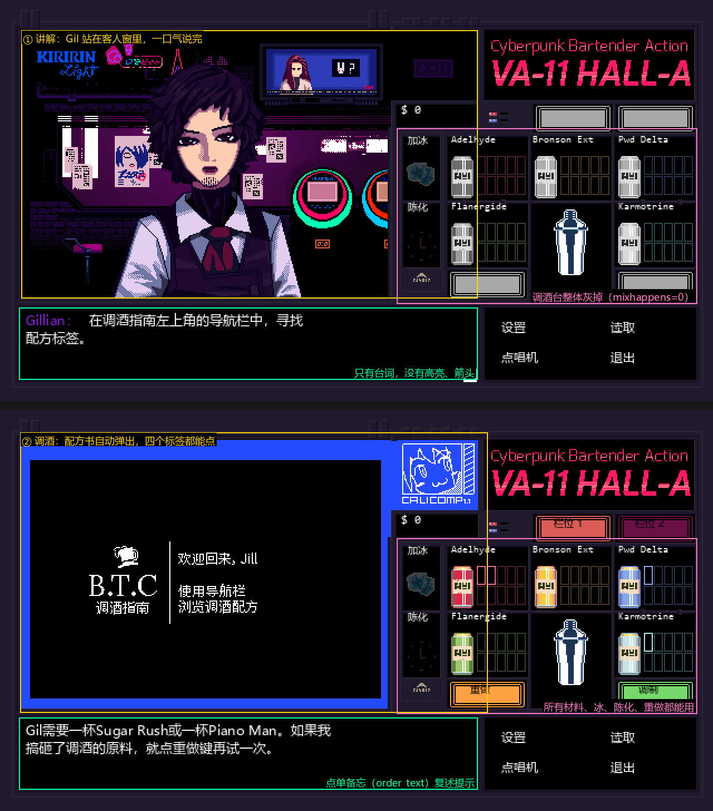
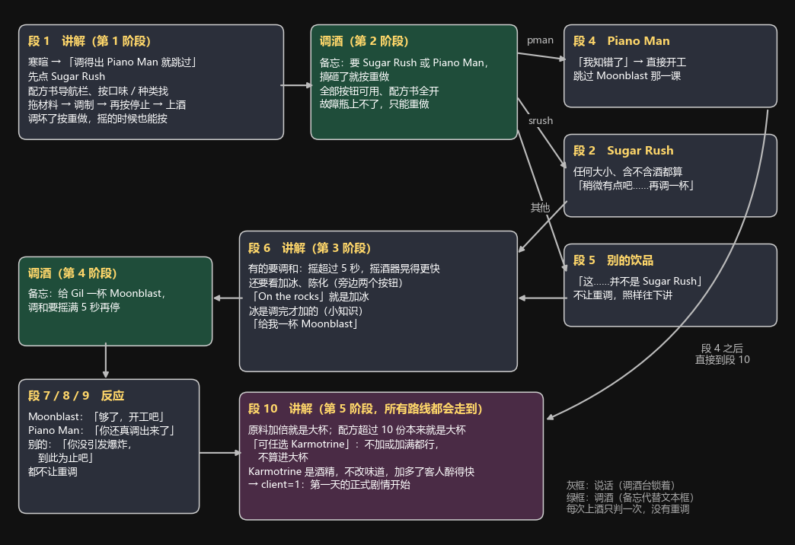

# 调研：原版的引导教程怎么教

地图票 `12-original-tutorial-research.md`（bar）的产出，调研日期 2026-10-26，给「拍板：第一次进酒吧的引导」（票 13）备料。对象是 Steam 版《VA-11 HALL-A》1.2.3.0。这份笔记只摆事实和可选的做法，拍板交给票 13。

来源写法：

- **代码**：从 `data.win` 副本反编译出的 GML，写成 `代码:mix1control`（即 `gml_Script_mix1control.gml`）或 `代码:order_text_Step_0`（即 `gml_Object_order_text_Step_0.gml`）。这是一手来源，冲突时以它为准。
- **剧本**：`VA11_extract/scripts/raw/{eng,chn,jp}/tutorial.txt`（带命令标签的原样副本），写成 `剧本:tutorial 第 N 行`，行号按英文版。三种语言的段落和命令标签一一对应（命令标签的种类和个数逐项比过；日文版开头的寒暄少一行，教学部分一样）。引用台词用官方中文版的短句。
- **段**：`textbox_create(文件, N, …)` 从剧本里第 N 个含 `[E:` 的行之后开始读（`代码:textbox_find_pointer_line`），所以「段 N」就是第 N 个 `[E:N]` 标记后面那一段。

## 结论

**整体怎么教**：原版的教程不是单独的模式，而是第 1 天开店前的一段戏。同事 Gillian（Gil）站在客人窗里，像客人一样点酒；每点一杯之前，先用一大段台词把下一杯要用到的操作一口气讲完，然后打开调酒台让玩家自己调，上酒后按 Gil 收到的是什么接不同的反应。一共最多两杯：Sugar Rush（拖材料、调制、上酒、重做），Moonblast（调和、加冰）；最后再口头讲一段大杯和 Karmotrine。画面上**没有**高亮、箭头、遮罩，也**没有**专门为教程锁按钮；唯一的提示是调酒时原本放点单备忘的地方，这时写的是这一步的要点（「搞砸了……就点重做键再试一次」「调和……至少放置5秒」）。调错了不让重来，Gil 说一句就照样往下讲，教程一定走得完。没有菜单里的「跳过」，戏里的跳过是「如果你能调出一杯Piano Man，我就会省略其他说明」；也没有重看入口。点唱机不在教程里，是教程结束、第 1 天剧情开场后，Jill 心里说一句「需要先选曲填满12个栏位才能开始播放」，紧接着弹出选曲界面，界面自己有两行操作说明。

**对我们的建议**（供票 13 参考，不是决定）：

1. **骨架照搬：两杯、讲解放在每杯之前、最后口头补一段。** 原版用 Sugar Rush（最基础的 mix）和 Moonblast（调和 + 加冰）就覆盖了调酒台的全部操作，这两款我们的 28 款里都有（票 05）。原版把大杯和 Karmotrine 放在两杯之后口头讲、不考；我们有「饮品名加大杯」这种说法（7%），如果想让玩家练一次大杯，可以把第二杯换成要大杯的，或者加第三杯，代价是引导变长。
2. **提示方式先照原版，靠台词和点单备忘，不锁按钮。** 原版证明了「不高亮、不锁」也教得会，而且和我们照原版画框（票 08）的方向一致，做起来最省。我们的点单备忘本来就是服务器按模板写的（票 05），引导时直接换成这一步的要点，正好对上原版的做法。原版的弱点是讲解一口气说完，调酒时翻不回去看（文字记录在配方书开着时打不开）；我们的备忘一直显示在侧边菜单上排，比原版好一些。要不要加高亮，可以留给原型票去试。
3. **出错照原版往下走，不卡人。** 原版每杯只判一次：调对、调成 Piano Man、调成别的，各接一段反应，然后都继续。这和票 07「上错照常往下走、不让重做」一致；故障瓶上不了只能重做，这条原版和我们也一样。引导里要是让玩家「必须调对才能继续」，就会和光顾里的规则不一样。
4. **跳过和重看要我们自己加。** 原版的跳过是戏里的考题（先调 Piano Man），重看只能新开游戏。我们的用户不能「新开一局」，所以跳过和以后重看的入口要另外放；原版这个「调得出难的就跳过」的办法，也可以给老玩家留着。
5. **点单的说法原版不教，我们至少要提一句。** 原版教程里两杯都是直说饮品名，只有一句「还可以通过“甜味”等口味和“男性化”等种类来为饮料分类」做铺垫，第 1 天的客人就直接用口味、种类、几个条件叠加、只给感觉的点法，靠点单备忘用 Jill 的口吻复述出来。我们有八种说法、讨厌的口味永远算错、头 3 次不出最难的两种（票 05），所以一句「她不一定直说名字，看备忘」就和原版的分量差不多；要讲细，原版没有可照搬的。
6. **点唱机放在引导之后，和用户的设想一致。** 原版就是「教程 → 剧情开场 → 一句心里话说明规矩 → 选曲界面 → 开工」，教程期间放的是固定曲 Every Day is Night，不经过点唱机。我们的选曲界面已经填好 12 首、Ready! 一进来就是绿的（票 11），「必须填满 12 首」这条规矩对玩家来说几乎没有存在感，一句话带过就够了。

## 1. 流程

上图：按反编译坐标用原版素材拼的示意图，2 倍放大；金额等数字是示意。下图是教程的状态机：

### 1.1 状态机

教程是第 1 天的「第 0 位客人」：新开游戏进第 1 天，`代码:dategetto` 设 `cur_client = 0`、`cur_stage = 1`，以后的每一天都从第 1 位客人开始。没有在说话的时候，`代码:dialog_control_Step_0` 每帧调 `daycontrol()`，第 1 天由 `代码:day1control` 按阶段决定读哪一段；上酒后由 `代码:mixcontrol` 转到 `代码:mix1control` 判定。剧本里的 `[XS:ph,N]` 改阶段，`[XS:mix,1]` / `[XS:mix,0]` 打开 / 关上调酒台，`[XS:client,1]` 切到下一位客人（`代码:textbox_var_set`）。

| 阶段 | 谁处理 | 做什么 |
|---|---|---|
| 1 | `day1control` | 醉意清零，点单备忘设成 `odstr1`，读段 1；段 1 末尾设阶段 2、打开调酒台 |
| 2 | `mix1control` | 记下上的是什么（`tutogil1`），不付钱（`mixertips(0,0,0,0)`）；Sugar Rush 读段 2，Piano Man 读段 4，别的读段 5 |
| 3 | `day1control` | 点单备忘设成 `odstr2`，读段 6；段 6 末尾设阶段 4、打开调酒台 |
| 4 | `mix1control` | 记下 `tutogil2`，不付钱；Moonblast 读段 7，Piano Man 读段 8，别的读段 9 |
| 5 | `day1control` | 读段 10；段 10 末尾设 `client=1`、阶段 1，第 1 天的正式剧情开始 |

段 2、段 5 都接阶段 3（第二课）；段 4、段 7、段 8、段 9 都接阶段 5（收尾讲解）。

### 1.2 逐步

| 步 | 剧本 | Gil 点的 | 这一步教了什么 | 画面上怎么提示 | 锁住的 |
|---|---|---|---|---|---|
| 开场 | 段 1，第 2–32 行 | — | 寒暄、Jill 的心事（剧情）；Gil 说「如果你能调出一杯Piano Man，我就会省略其他说明」 | Gil 立绘出现在客人窗单人位（`[SHOW:185,sprite_gil]`）；只有台词 | 调酒台整体不可用（说话时都这样，不是教程专有） |
| 讲解一 | 段 1，第 33–41 行 | 「那就先从调一杯Sugar Rush做起吧」 | 1. 左上角调酒指南的导航栏找配方；2. 可以按口味、种类给饮料分类；3. 把原料从栏位拖到中央的摇酒壶；4. 点调制，再点一次结束调制；5. 点上酒按钮或饮料本身来上酒；6. 调糟了点重做，摇的时候也能按 | 只有台词，9 句一口气讲完，中间不打开调酒台 | 同上 |
| 第一杯 | — | Sugar Rush 或 Piano Man | 玩家自己调 | 配方书自动弹出（停在首页「使用导航栏浏览调酒配方」）；文本框的位置换成点单备忘：「Gil需要一杯Sugar Rush或一杯Piano Man。如果我搞砸了调酒的原料，就点重做键再试一次。」（`odstr1`） | 不锁：五种材料、加冰、陈化、重做、调制、配方书四个标签、全部 28 款都能用 |
| 反应 | 段 2 / 4 / 5 | — | Sugar Rush：「稍微有点吧……咱们再调一杯」；Piano Man：「我知错了」，直接开工；别的：「这……并不是Sugar Rush」，「咱们再来调杯别的」 | 只有台词；`[RES:]` 清空调酒台 | — |
| 讲解二 | 段 6，第 59–69 行 | 「给我一杯Moonblast」 | 1. 有的饮料要调和：调制超过五秒就成了调和，摇酒壶开始快速晃动就是在调和；2. 看配方要不要陈化或加冰，用旁边的加冰、陈化按钮；3. 「On the rocks」就是加冰；4. 冰是调制完成后才加（「只是个有趣的事实而已」） | 只有台词，10 句 | 调酒台不可用 |
| 第二杯 | — | Moonblast（Piano Man 也收） | 玩家自己调 | 点单备忘：「来给Gil调一杯Moonblast。调和饮品需要在点击调制之后至少放置5秒，之后再停下摇酒壶。」（`odstr2`） | 不锁 |
| 反应 | 段 7 / 8 / 9 | — | Moonblast：「够了」；Piano Man：「你还真成功调出了Piano Man」；别的：「你毕竟没在调酒时引发爆炸。那就到此为止吧」 | 只有台词 | — |
| 收尾讲解 | 段 10，第 85–94 行 | 不点 | 1. 原料加倍就是大杯；2. 配方超过 10 份的本来就是大杯；3. 「可任选Karmotrine」是不加或加满都行；4. 可选的 Karmotrine 不算进大杯；5. Karmotrine 是酒精，不改味道，加多了顾客更容易醉 | 只有台词，6 句；不考 | 调酒台不可用 |

几处细节：

- **判定很宽**：第一杯只看 `bevid_a == "srush"`，大杯、含不含 Karmotrine 都算 Sugar Rush（`代码:mix1control`、`代码:drink_a`）。第二杯同理，只看是不是 Moonblast。
- **配方书**：调酒台一打开就自动弹出（`代码:dialog_control_Step_0`：`mixhappens == 1` 且没在说话时创建 `recipebook_bg` 和 `order_text`）。剧本里有 `[SRB:]`（显示配方书）这个命令，教程没用。
- **点单备忘的位置**：原版的备忘画在文本框原来的位置 (15,275)，宽 380（`代码:order_text_Create_0`、`order_text_Draw_0`），一开始说话就被销毁（`代码:order_text_Step_0`）。
- **讲解时翻不回去**：文字记录（Tab 或滚轮）只有在说话、且配方书没开时才能打开（`代码:log_obj_Step_0`），最多留 30 句。所以调酒时看不到 Gil 刚才的讲解，只有备忘那一两句。
- **快进**：按住 Ctrl 能一直翻页（`代码:adv_txt_alt`），这是全游戏通用的，不是教程专有。
- **音乐**：第 1 天开店放固定曲 Every Day is Night，不经过点唱机（`代码:mixershow_Create_0`）。
- **钱**：教程里四种结果都是 `mixertips(0,0,0,0)`，不付钱、没小费。
- **台词量**：Gil 教操作的台词一共约 25 句（段 1 九句、段 6 十句、段 10 六句），前后都是剧情。

## 2. 出错时、跳过、重看

- **调糟了（故障瓶）**：上不了，调制 / 上酒按钮变不可用，只能按重做（故障瓶的规则见票 01 的调研笔记 `drinks.md`）。教程用两处来提醒：讲解一的「如果调出的饮料看上去很糟的话，你还需要点击重做按钮」「你随时都可以点击重做」，以及第一杯的点单备忘。
- **上错了（调成另一款合法的）**：不让重做。第一杯上错读段 5，Gil 说「这……并不是Sugar Rush」，然后照样进第二课；第二杯上错读段 9，然后照样收尾。也就是说，第一杯错了的人第二课照样上，第二杯错了的人也照样开工，教程一定走得完，最多两杯。
- **调和过头**：比如把 Sugar Rush 摇成了调和，配方对不上，就是故障瓶，只能重做（`代码:drink_a`：Sugar Rush 要求 `!failed_a`）。剧本里有一段 Gil 说「你调制的时间过长了。这杯因此被调和成了Sparkle Star」（段 3，第 49–52 行），但**没有任何代码会读这一段**（全部 GML 里 `global.tuto` 只读了段 1、2、4、5、6、7、8、9、10）。这句的说法本身也和配方对不上：Sparkle Star 是 Sugar Rush 加陈化，不是调和。推断是旧版本留下的死段落。
- **记下了但没用**：两杯上的是什么记在 `tutogil1`、`tutogil2`，全部 GML 和剧本里除了清零再没有读它，之后的剧情不会提起教程里调得怎么样。
- **能不能跳过**：菜单和设置里没有「跳过教程」（英文字符串表里除了剧本路径，没有任何含 tutorial 的界面文字）。戏里的跳过是第一杯直接调出 Piano Man（Promo 类、18 份、加冰、mix），这时跳过第二课，但收尾讲解（段 10）照样要听。
- **以后能不能重看**：没有重看入口。教程绑在「第 1 天、第 0 位客人」上，只有新开游戏，或读第 1 天进酒吧之前的存档，才会再走一遍。

## 3. 教了什么、没教什么

**教了的**（都只靠台词，打勾的是有一杯酒让玩家实际做的）：

- [x] 拖材料进摇酒壶
- [x] 调制按两次（开始、停止），上酒（按钮或点饮料）
- [x] 重做，摇的时候也能按
- [x] 配方书的导航栏；可以按口味、种类找（只提了一句，没要求用）
- [x] 调和：摇超过 5 秒，摇酒壶晃得更快
- [x] 加冰（第二杯 Moonblast 要加冰）
- [ ] 陈化（讲了按钮，两杯都不用）
- [ ] 大杯：原料加倍、超过 10 份本来就是大杯
- [ ] 可选 Karmotrine：0 到加满都行，不算进大杯
- [ ] Karmotrine 是酒精，不改味道，加多了醉得快

**没教的**：

- **客人点单的不同说法**：教程两杯都是直说饮品名。第 1 天正式剧情里马上就有按种类（「一杯时尚饮料」）、几个条件叠加（「小杯，甜味，加冰」）、只给感觉（「给她一杯能让她冷静下来的东西」）的点法，还有喝醉时改点「苦味的，大杯的，而且不含酒精」。这些都没有额外说明，靠点单备忘用 Jill 的口吻复述（`代码:order_tl_ch` 的 `odstr6`、`odstr11`、`odstr12`、`odstr14`）。
- **钱、小费、房租**：教程里不收钱。房租只在 Jill 的心事里出现，是剧情，不是操作说明。
- **醉的门槛和后果**：只说「加多了顾客更容易醉」，不说多少算醉、醉了会怎样。
- **配方书的「瓶装饮料」标签**、**两个栏位**（只在少数几天用到）、**电视**（教程里只用来接剧情）、**设置、读取、退出**、**文字记录**。
- **键盘快捷键**：游戏里任何地方都没写（英文字符串表里没有说明快捷键的文字），只有 Steam 指南这类二手资料列了。

## 4. 点唱机第一次怎么出现

- **不在教程里**。教程期间放固定的 Every Day is Night（`代码:mixershow_Create_0`），侧边菜单的「点唱机」点了没反应：小播放器要 `can_minijuke = 1`，而这个值只有在选曲界面点完 Ready 才设（`代码:side_jukebox_Mouse_4`、`代码:jukebox_done_Mouse_4`）。
- **出现在第 1 天剧情开场的末尾**（`剧本:script1` 第 1 段，英文版第 35–37 行）：Dana 带着昏迷的女孩进来、Jill 把 Gil 打发去打扫厕所之后，Jill 心里说三句：用新的「点唱机」放些音乐；「这个型号需要先选曲填满12个栏位才能开始播放」；「搞不懂这个决策有什么逻辑可言……」。这一段末尾 `[XS:juke,1]`，没在说话时 `dialog_control` 就创建选曲界面。
- **界面自己的说明**：标题框「请选择一首曲子」，下方两行说明「点击左侧的曲名来添加曲目。」「右键点击曲名可移除曲目，点击两首曲目可替换顺序。」（`代码:ui_tl_ch` 的 `pleasesong`、`instructionjuke1/2`，画在 (26,279) 和 (26,298)，`代码:jukebox_text_Draw_0`）。日文版第一句写成了「右側」，和画面不符。
- **必须选完**：12 个槽没填满，Ready 点了没用（`代码:jukebox_done_Mouse_4`）；选曲时侧边菜单、离开都不可用（`代码:side_menus_Draw_0`、`door_exit_Step_0` 要求 `jukebox_happens == 0`）。选完响一声、开始放歌单，接着读下一段「Time to mix drinks and change lives.」，第一位客人进门（`代码:jukebox_advance`）。
- **之后每天**：每天开场和中途休息回来之后都会再弹一次（`剧本:script*` 里的 `[XS:juke,1]`，比如第 1 天休息回来是 `script1` 第 89 段之前那句），不再解释。歌单是全局变量，只有新开游戏才清空，所以第二天起槽里是上次选的。原版有少数几首要在商店买或剧情推进后才解锁，之前显示「???」（`代码:song_unlock_juketext`）；我们这一版是全部解锁（票 11）。

## 5. 映射到我们这一版

对照的是票 05、07、08、11 的 Answer 和地图的 Decisions so far。

### 5.1 原版教过、照搬就行

| 原版教的 | 原版怎么教 | 我们这一版对应的 | 备注 |
|---|---|---|---|
| 拖材料进摇酒器 | 讲解一 + 第一杯 | 照原版拖，鼠标和触屏都能拖（票 08） | 手机上「拖」要不要多一句，原版没有可参考的 |
| 调制按两次、上酒 | 讲解一 + 第一杯 | 同（调制 / 停止 / 上酒同一个按钮，票 08；原型里调好后点摇酒器也能上，`pieces.tsx` 的「上酒」热区） | 原版说「点击上酒按钮或饮料本身」 |
| 重做，随时能按 | 讲解一 + 第一杯备忘 | 同 | |
| 调坏了只能重做 | 讲解一「看上去很糟……点击重做」 | 故障瓶不能上，飘「失败」，按钮变 `mix_no`（票 07、08） | 一致 |
| 配方书导航栏、按口味 / 种类找 | 讲解一一句 | 配方书照原版四个标签（票 05、08） | 原版只提口味和种类，没提名称和瓶装 |
| 调和：摇超过 5 秒、摇得更快 | 讲解二 + 第二杯（Moonblast） | 同（票 08） | |
| 加冰、陈化按钮；On the rocks 就是加冰 | 讲解二 + 第二杯 | 同 | 陈化原版只讲不练 |
| 大杯：原料加倍，超过 10 份本来就是大杯 | 收尾口头讲 | 同（票 01：大杯全部翻倍） | 我们有「饮品名加大杯」的说法，可以考虑练一次 |
| 可选 Karmotrine 不算大杯 | 收尾口头讲 | 同 | |
| Karmotrine 是酒精，加多了醉得快 | 收尾口头讲 | 醉按 Karmotrine 累计、门槛按酒量（票 07） | 原版只讲到这一句，门槛不讲；我们界面也不显示醉意 |
| 上错不让重来，照样往下 | 段 5、段 9 | 上错照常往下走、不让重做（票 07） | 一致 |
| 说话时调酒台锁着，轮到调酒才打开 | 全游戏通用 | 原型里 `talk` 阶段按调酒台只响 `noclick` | 一致 |
| 点单备忘复述要点 | 两杯的备忘都写了这一步的提示 | 点单备忘由服务器按模板写（票 05），放侧边菜单上排（票 08） | 位置不同：原版在文本框位置，我们在侧边菜单 |
| 开店前先选 12 首 | 教程之后，一句心里话 + 选曲界面两行说明 | 每次先过选曲界面，已填好、Ready! 是绿的（票 11） | 原版要自己填满 12 首，我们已经填好 |

### 5.2 我们新加、原版没教的

| 我们的玩法 | 原版的情况 |
|---|---|
| 点单的八种说法（直说名、加大杯、口味、种类、条件叠加、打比方、「来杯我喜欢的」、「你拿主意」，加「老样子」）（票 05） | 教程不讲。直说名字、口味、种类、条件叠加、只给感觉第 1 天就有，靠备忘复述；「来杯我喜欢的」「老样子」原版没有对应的点法 |
| 她讨厌的口味永远算上错（票 05） | 没有对应 |
| 上得最好 / 上对 / 上错三档，结束卡只给抽奖和好感度方向（票 07） | 原版用钱和小费，教程里不付钱，也没讲 |
| 醉的门槛按酒量，界面不显示（票 07） | 只讲「加多了更容易醉」 |
| 键盘快捷键 Q W E R T、Shift、A、S、空格（票 08） | 游戏里没写 |
| 点单备忘放在侧边菜单上排（票 08） | 原版备忘在文本框位置，教程期间写的是提示 |
| 电视点一下换台（票 08） | 有电视但教程不讲 |
| 配方书「瓶装」标签，瓶装 4 款一直都在（票 05） | 教程不提瓶装 |
| 点唱机：默认 12 首、试听、手机长按（票 11） | 原版选曲界面有两行说明，没有试听；手机操作原版没有 |
| 「离开」、结束卡、「再营业」（票 08） | 原版没有对应 |
| 开店画面（店门口，点一下进门）（票 08） | 原版每次进酒吧都有，教程不讲 |
| 每天第一次玩完给抽奖、好感度上升（定图时、票 07） | 没有对应 |
| 手机横屏、竖屏提醒、安卓全屏（定图时、票 08） | 没有对应 |

## 6. 没核实的地方

- **没有实际跑游戏**。流程、跳转、按钮可不可用全部是从反编译代码和剧本推出来的；配图是按反编译坐标用素材拼的示意图，配方书首页的位置是估的，金额是示意。
- **段 3（调和成 Sparkle Star）是死段落**：「没有代码读它」是对全部 GML 搜 `global.tuto` 得出的，已核实；「是旧版本留下的」是推断。
- **重看只能新开游戏或读档**：第 1 天在家里能存档（`代码:save_home_Step_0` 只在第 0 天限制），但没有实际验证第 1 天进酒吧前能不能存、读这个档会不会重新走一遍教程。
- **游戏外的说明**：Steam 商店页、说明书、成就提示里有没有教玩法，没查。
- **教程期间的电视、文字记录、读取、设置**：只看了它们的开关条件，没有逐个确认在教程里点下去的表现。
- **其他语言**：只比对了英、中、日三种剧本，其他语言没看。

## 7. 复现

- 反编译：照票 03 笔记第 6 节的办法。把安装目录的 `data.win` 复制到 `E:\tmp\bar-tutorial-research\work\game\`，把副本偏移 72 处的 u32 从 1757 改成 1773，用 UndertaleModTool CLI 0.9.2.0 跑 `UndertaleModCli dump <副本> -v -o <out> -c UMT_DUMP_ALL -s`，得到 2288 个 GML 文件和字符串表。安装目录没有改动。
- 用到的 GML：`gml_Script_day1control`、`gml_Script_mix1control`、`gml_Script_mixcontrol`、`gml_Script_mixertips`、`gml_Script_textbox_var_set`、`gml_Script_textbox_create`、`gml_Script_textbox_find_pointer_line`、`gml_Script_textbox_cmd_execute`、`gml_Script_adv_txt_alt`、`gml_Script_dategetto`、`gml_Script_drink_a`、`gml_Script_order_tl_ch/eng/jp`、`gml_Script_ui_tl_ch/eng/jp`、`gml_Script_jukebox_advance`、`gml_Object_dialog_control_Step_0`、`gml_Object_order_text_*`、`gml_Object_log_obj_Step_0`、`gml_Object_mixershow_Create_0`、`gml_Object_jukebox_done_Mouse_4`、`gml_Object_jukebox_text_Draw_0`、`gml_Object_side_jukebox_Mouse_4`、`gml_Object_obj_textbox_Create_0`、`gml_Object_save_home_Step_0`。
- 配图：脚本 `E:\tmp\bar-tutorial-research\scripts\tutorial_figs.py`（`python -I tutorial_figs.py <VA11_extract/sprites> <sprite_frames.tsv> <输出目录>`），精灵的透明边偏移用票 03 导出的 `sprite_frames.tsv`。反编译代码、剧本全文、脚本都不进仓库。
